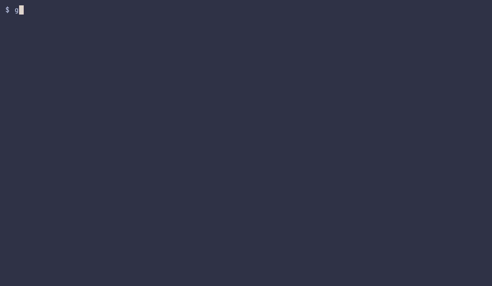

# ghwatch

Watch the CI of your GitHub pull requests from the terminal: one tab per PR,
every check with its state, and a desktop notification when a job fails.
Works with GitHub Actions and with external CI such as Prow / OpenShift CI.



## Quick start

```sh
go install github.com/clobrano/ghwatch/cmd/ghwatch@latest
ghwatch
```

Press `a`, paste a pull request URL, and it shows up in a new tab. ghwatch
uses your `gh` login (or `$GITHUB_TOKEN`), so there is nothing else to set up.

The keys you need day to day:

| Key | Action |
| --- | --- |
| `h` / `l` | previous / next PR |
| `j` / `k` | next / previous thread or job |
| `v` | switch between the PR's comments and its checks |
| `enter` | open the selected comment, or job, in the browser |
| `r` / `R` | reply in a comment thread / resolve it |
| `o` | open the PR in the browser |
| `a` / `d` | add / remove a PR |
| `?` | all the other keys, and (`tab`) what the icons mean |
| `q` | quit |

The footer always shows the main keys. [docs/tui.md](docs/tui.md) describes
the screen in detail.

## Notifications

Notifications are off until you ask for them:

- `n` on a PR: notify about its checks (failures, all passed, new push,
  merged) and new comments.
- `b` on a comment thread: notify about new comments in it. On a job
  (press `v` to see the checks): notify about that job only.
- `m` on a PR: mute all its notifications; `m` again restores them as
  they were.
- `c` on a PR: clear all its notifications, the PR's, its jobs' and its
  threads'.
- `N`: choose which events notify, or mute everything.

Notifications stay on screen for 30 seconds (`timeout` below), where the
desktop allows it (GNOME ignores it and uses its own, shorter timing). They need
`notify-send` (libnotify). Clicking one opens the job or PR page.

Even without notifications, nothing goes unnoticed: a PR whose state
changed since you last looked gets an orange `•` on its tab, and the
title bar counts them (`•2 new`). New comments, in the conversation or on
code, get a comment mark with their count on the tab, and are listed
first. Both clear when you go to that tab.

## More

### tmux status line

```tmux
set -g status-right '#(ghwatch status) %H:%M'
set -g status-interval 10
```

This shows e.g. `PR ●3 ✓5 ✗1 •2 4`: running, passed and failed PRs, how
many changed since you last looked, and how many new comments
(after a comment mark). A trailing `!` means the data is stale.
`ghwatch status` reads a local file, so it costs nothing to refresh often.

ghwatch uses 24-bit colors. Inside tmux, enable true color, or the colors
are approximated:

```tmux
set -as terminal-features ',xterm-256color:RGB'
```

### Notifications without a TUI open

ghwatch runs a small background process (the daemon) that polls GitHub for
every open TUI. The TUI starts it, and it stops 10 seconds after the last
TUI closes. To keep notifications and the tmux line live with no TUI open,
run it yourself, for example in a tmux window:

```sh
ghwatch -serve
```

### Command line

```sh
ghwatch add <PR URL or owner/repo#N>   # watch a PR
ghwatch rm <PR>                        # stop watching it
ghwatch ls                             # list watched PRs
ghwatch checks <PR>                    # print a PR's checks, fetched now
ghwatch status [-json]                 # one-line summary, or the full state
ghwatch stop                           # stop the daemon, e.g. after a rebuild
ghwatch icons                          # preview the icon sets
```

### Configuration

Optional, in `~/.config/ghwatch/config.toml`. ghwatch writes this file on
its first run, with every setting commented out at its default, so you
can see what is there and uncomment what you want to change; it never
touches an existing file. For example:

```toml
interval = "30m"            # how often to poll GitHub (minimum 10s); p polls at once
browser = "firefox"         # default: $BROWSER, then xdg-open
icons = "fancy"             # or "safe" if some icons show as boxes
theme = "frappe"            # Catppuccin flavor: latte, frappe, macchiato or mocha
status_template = 'PR {{if .Failed}}{{icon "failed"}}{{.Failed}}{{end}}'

[notify]
backend = "desktop"         # desktop | exec | none
timeout = "30s"             # how long notifications stay on screen
# command = "curl -s -d @- ntfy.sh/my-topic"   # for backend = "exec"

[comments]
ignore_authors = ["openshift-ci-robot", "openshift-merge-robot"]

[autoadd]
review_requested = true     # watch PRs requesting your review
assigned = true             # watch PRs assigned to you
max = 20                    # at most this many auto-added PRs at once
repos = ["my-org/*"]        # only these repositories (globs); all when empty
```

- **Theme:** the colors are a [Catppuccin](https://catppuccin.com)
  flavor, Frappé by default. ghwatch keeps your terminal's background,
  so pick the flavor closest to it (`latte` for a light one).
- **Icons:** `icons = "safe"` uses characters every common monospace font
  has. Run `ghwatch icons` to compare the sets in your terminal.
- **Status template:** a Go `text/template` over `.Running`, `.Pending`,
  `.Passed`, `.Failed`, `.Queued`, `.Merged`, `.Closed`, `.Total`,
  `.Unseen`, `.Comments` and `.Stale`. `{{icon "<state>"}}` prints a
  state's icon, and `{{icon "comment"}}` the comment mark.
- **Ignored authors:** comments by these GitHub logins are never new and
  never notify, e.g. CI bots. Empty by default: bots count like everyone.
  Your own comments never count.
- **Exec notifier:** the `exec` backend pipes each notification as JSON
  to `command`, to send it anywhere, e.g. ntfy.sh or a chat webhook.
- **The watched PRs** are in `~/.config/ghwatch/watch`, one per line. You
  can edit the file by hand.
- **Auto-add:** with `review_requested` and/or `assigned` on, ghwatch
  adds the open PRs requesting your review (from you, not your teams) or
  assigned to you, at each poll. `repos` limits it to repositories
  matching its patterns (`owner/repo`, with `*`, `?` and `[...]`:
  `"my-org/*"` is every repository of my-org); without it, every
  repository counts. They are marked `# auto: …` in the
  watchlist and get an `added:` row in the TUI. See
  [keeping the tab list short](#keeping-the-tab-list-short).

### Keeping the tab list short

ghwatch removes an auto-added PR on its own when it no longer calls for
you: you were removed from its reviewers (or removed yourself) without
reviewing it, or you were unassigned. A message says so, and the PR comes
back if it calls for you again. It stays when you reviewed it, since
that is when the author's answer matters, and after it is merged or
closed. To stop seeing auto-added PRs yourself:

- **One PR:** press `d` on its tab (or `ghwatch rm <PR>`, or delete its
  line in the watchlist). An auto-added PR removed this way is dismissed:
  it is not added again, even while your review is still requested. To
  follow it again, add it back with `a` or `ghwatch add`.
- **Fewer repositories:** list the ones you want in `repos`. Auto-added
  PRs from a repository no longer listed are removed, unless you reviewed
  them.
- **Fewer at once:** lower `max` under `[autoadd]` (20 by default). Once
  that many auto-added PRs are watched, no more are added until you
  remove some.
- **None at all:** set `review_requested` and `assigned` back to `false`
  (or delete them), then run `ghwatch stop`. No more PRs are added, but
  the ones already added stay: remove them with `d`, or delete their
  `# auto:` lines in the watchlist.
- **Keep it, without the noise:** `m` mutes a PR's notifications.

Dismissals live in ghwatch's state file
(`~/.local/state/ghwatch/snapshot.json`): if that file is deleted, the
PRs you dismissed can be added again.

### Requirements

- A GitHub token: `gh auth login`, or `$GITHUB_TOKEN`.
- Linux; it also builds on macOS and the BSDs, where notifications need the
  `exec` backend.
- Optional: `notify-send` for notifications, `xdg-open` (or `$BROWSER`) for
  links, and a [Nerd Font](https://www.nerdfonts.com/) for the alert bell
  and, with the fancy icons, the comment mark (`icons = "safe"` uses a
  `c` instead).

## Development

[docs/development.md](docs/development.md) covers how ghwatch works, the code
layout, extension points and re-recording the demo.
[docs/decisions.md](docs/decisions.md) explains the design choices, and
[docs/snapshot.md](docs/snapshot.md) the state format other tools can read.
